

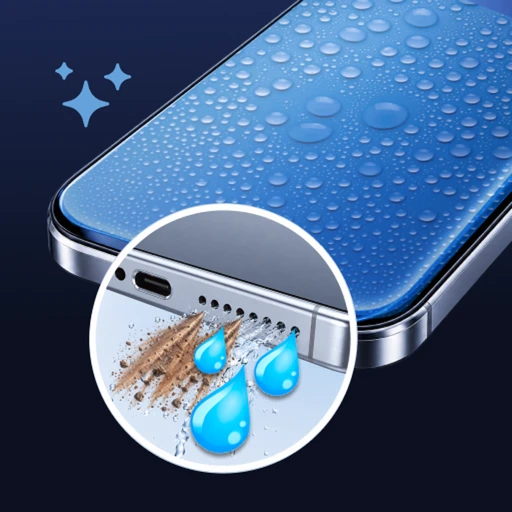

# Speaker Cleaner

**An Android utility that plays device-synthesized tone sequences through the loudspeaker: preset multi-stage cycles, a user-tuned manual mode, and a speaker check that sweeps reference tones and pink noise per channel. This portfolio describes the software only; it does not claim that any mode removes water or dust or repairs hardware.**

**Android (Google Play)** 
Flutter · Dart · PCM synthesis · audioplayers · audio_session · Firebase

<table>
  <tr>
    <td align="center">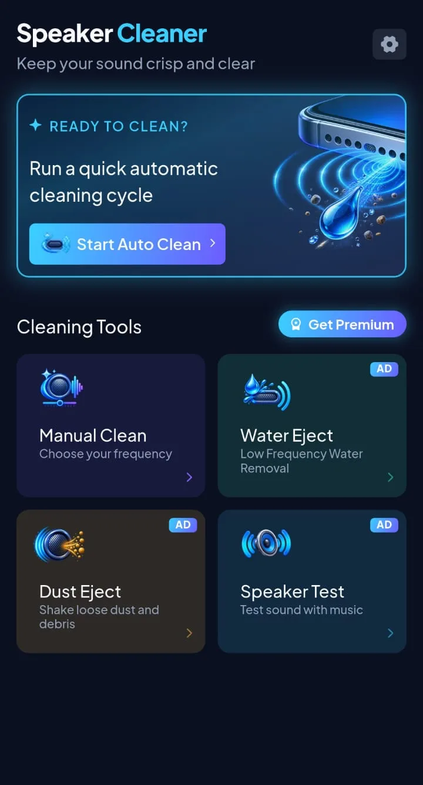</td>
    <td align="center">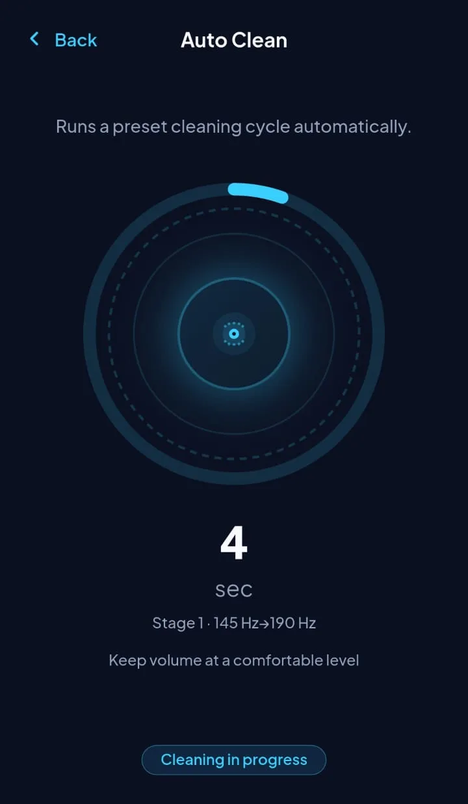</td>
  </tr>
</table>
Real screenshots from the Android build, cropped to the app content (system status bar and ad-placeholder strips removed), captured with sample data, metadata removed. On-screen marketing lines are the app’s own copy; what each mode actually does is summarized in the tables below.

---

## Get the App

  

The released product is **Android only** on Google Play. The Flutter project also contains iOS-oriented dependencies (for example a tracking-consent prompt), but this repository does not link to an App Store listing.

## Product at a Glance

| | |
|---|---|
| **What it is** | A tone-sequence player with five modes, first-run onboarding, settings, and optional premium subscription |
| **Core behaviour** | Each mode renders ordered stages (frequency sweeps, steady tones, pulsed tones, pink noise) into 16-bit PCM at 44.1 kHz, then plays them through the device speaker at a capped digital gain |
| **Auto Clean** | About 80 seconds, six numbered sweep and steady stages spanning roughly 145 Hz to 1.5 kHz |
| **Water Eject** (UI label) | About 45 seconds of low-frequency ramps, sweeps, and pulsed tones (roughly 145–220 Hz) |
| **Dust Eject** (UI label) | About 50 seconds of mid/high sweeps and short steady tones (roughly 300 Hz–2 kHz) |
| **Manual Clean** | 30-second cycle; the user picks a frequency between 100 Hz and 2.5 kHz while a continuous tone runs in small generated chunks |
| **Speaker Test** | Reference tones, a wide sweep, and pink noise played separately for left, right, and stereo routing |
| **Monetisation** | Premium subscription (monthly and yearly) removes ads; three modes are gated behind a watch-ad-or-subscribe choice for free users |
| **Languages** | Eleven selectable interface languages |
| **Services** | Firebase (Analytics, Crashlytics, Performance, Cloud Messaging, Cloud Firestore for ad switches), Google Mobile Ads with consent form, Play Billing, Play in-app updates |
| **Code size** | 78 hand-written Dart files and about 21k lines under the app library tree (excluding generated localisation), plus six automated test files |

## What “cleaning” means here

Every mode is **audio output only**: the app generates waveforms on the device and plays them. There is no microphone analysis, no moisture sensor, and no feedback loop that measures speaker condition. Mode names and illustrations in the store and in the UI are product labels; **this write-up does not state that playing these tones removes liquid, dislodges debris, or fixes a damaged speaker.**

## Product Showcase

<table>
  <tr>
    <td align="center">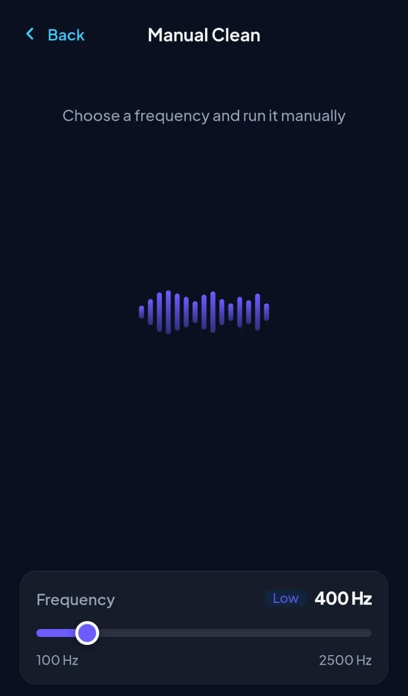 <b>Manual Clean</b> User frequency and 30 s timer</td>
    <td align="center">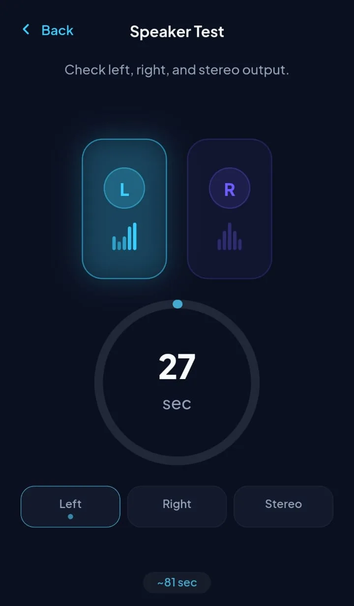 <b>Speaker Test</b> Per-channel reference sequence</td>
    <td align="center">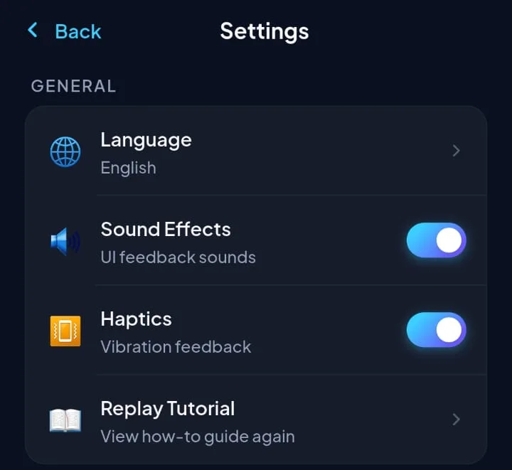 <b>Settings</b> Feedback toggles and links</td>
    <td align="center">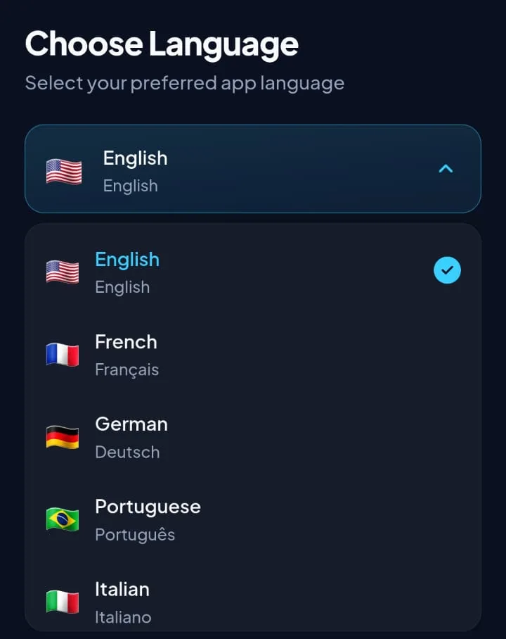 <b>Language</b> First-run picker</td>
    <td align="center">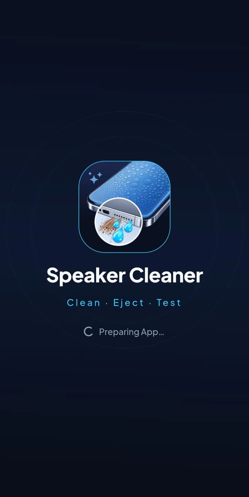 <b>Splash</b> Startup gate</td>
  </tr>
</table>

## Key Features

- **Preset sequences.** Auto, Water, and Dust modes each follow a fixed ordered list of stages defined in one place and rendered as a single continuous waveform so there are no audible gaps between stages.
- **Manual frequency control.** While a manual cycle runs, the synthesizer re-reads the slider value every chunk so the tone can track user adjustments in real time.
- **Speaker test routing.** The same reference sequence is synthesized three times with left-only, right-only, or both channels driven so the user can compare channels by ear.
- **Progress UI.** Playback position from the native player drives countdown text, a ring progress indicator, and localized stage labels (sweep range, pulse, pink noise, and similar).
- **Comfort guardrails.** Copy on mode screens reminds users to keep volume at a comfortable level; digital gain is scaled down in the generator.
- **Lifecycle-aware stop.** Tones keep playing when the notification shade or a permission dialog briefly covers the app, but stop when the app is backgrounded or torn down.
- **Separate UI sounds.** Button taps use a short bundled click sample on a second player so feedback never shares the cleaning audio session.
- **First-run flow.** Language selection, three onboarding pages, and a four-step tutorial before the home hub appears.
- **Premium and ads.** Subscription turns ads off; free users see banner slots on several screens, optional interstitials after some cycles complete, a startup app-open placement, and rewarded gating on three tools.

## Engineering Highlights

### One waveform, many stages, no clicks
- **Problem:** Restarting the player between stages would insert gaps and discontinuities at every boundary.
- **Approach:** All stages in a preset are rendered into one phase-continuous PCM buffer with short edge fades, an overall fade in/out, and specialized envelopes for pulse on/off and pink-noise segments.
- **Outcome:** Each preset plays as one uninterrupted file; the UI still knows which stage is active by mapping elapsed time back onto the stage list.

### Large buffers without blocking the UI thread
- **Problem:** Shipping multi-megabyte WAV bytes across the platform channel on every play can stall Android during transitions.
- **Approach:** Long sequences are written to a single temporary file on disk and played by path; short one-off tones still use in-memory bytes. The previous temp file is deleted when superseded.
- **Outcome:** The heaviest mode keeps channel traffic small while the native side streams from disk.

### Audio focus that matches a utility tone
- **Problem:** Default session presets can pause cleaning when the user opens the notification shade on some OEM builds.
- **Approach:** The session is configured for sonification-style playback with ducking that lowers volume instead of pausing; backgrounding still hard-stops output.
- **Outcome:** Deliberate in-app tones survive transient system overlays but do not continue when the user leaves the app.

### Ad configuration that fails closed
- **Problem:** Ads must be remotely switchable without shipping a new build, and a failed config fetch must not default to showing ads.
- **Approach:** A cloud document must be read successfully before any placement is treated as enabled; each placement needs an explicit true flag, plus a global kill switch. Premium skips all formats.
- **Outcome:** Offline or failed reads mean no ads until a confirmed snapshot arrives.

More detail: [docs/ENGINEERING_CHALLENGES.md](docs/ENGINEERING_CHALLENGES.md).

## Architecture

  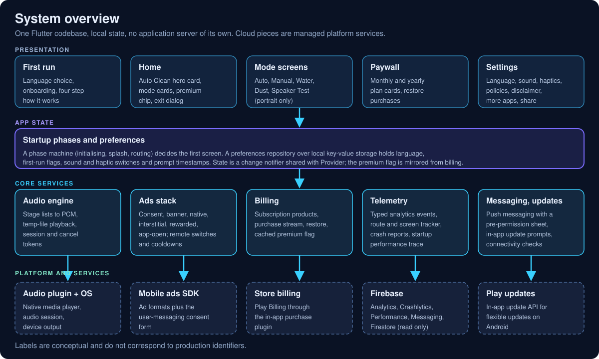

  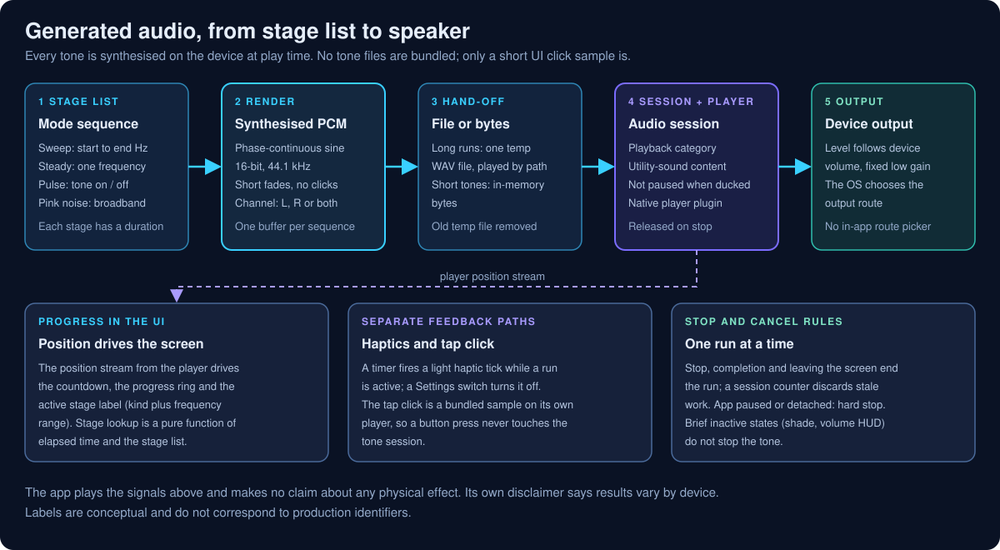

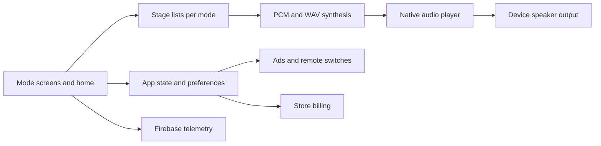

Details: [docs/ARCHITECTURE.md](docs/ARCHITECTURE.md).

## Technology Stack

| Layer | Technology |
|---|---|
| App | Flutter / Dart 3, `provider`, generated localisation (11 languages) |
| Audio | In-app PCM synthesis (sine sweeps, pulses, pink noise), `audioplayers`, `audio_session` |
| UI assets | Bundled SVG illustrations, one short MP3 tap sample, locally bundled font family |
| Storage | `shared_preferences` for first-run flags, language, haptics/sound toggles, snooze timestamps |
| Backend | Firebase: Firestore (remote ad flags), Analytics, Crashlytics, Performance, Messaging |
| Ads | Google Mobile Ads, User Messaging Platform consent, rewarded / interstitial / banner / app-open placements |
| Billing | `in_app_purchase` with Play Billing on Android |
| Extras | Play in-app update API, local notifications prompt, connectivity check for rewarded loads |
| Testing | `flutter_test`: six test files covering preferences, routing, paywall layout, WAV headers, and an ad loading dialog |

## Documentation

| Read | For |
|---|---|
| [Technical case study](docs/TECHNICAL_CASE_STUDY.md) | How tones are built, played, and wired to the UI |
| [Architecture](docs/ARCHITECTURE.md) | Layers, startup phases, and service boundaries |
| [Engineering challenges](docs/ENGINEERING_CHALLENGES.md) | Problem, approach, trade-offs, outcome |
| [Product overview](docs/PRODUCT_OVERVIEW.md) | Screens, modes, and monetisation behaviour |
| [Privacy and source](docs/PRIVACY_AND_SOURCE.md) | What is and is not published |

## Source Code

This repository is a portfolio showcase for a production application. Production source code is maintained privately. See [RIGHTS.md](RIGHTS.md) for usage terms.
