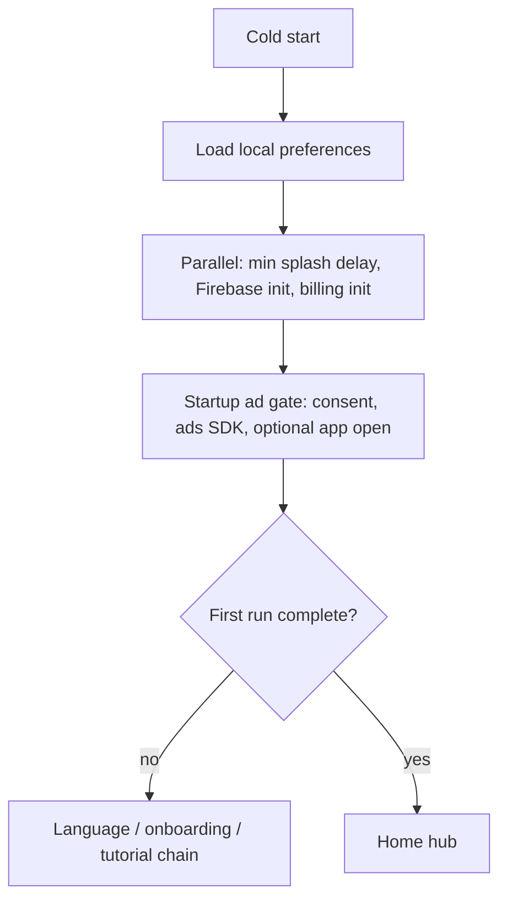

# Architecture

Speaker Cleaner is a single Flutter application with no custom application server. Cloud touchpoints are managed platform services (Firebase, Play, ad SDKs). The diagram in `assets/diagrams/system-overview.svg` matches this document at a high level.

## Layered view

### Presentation

Screens are organized by feature:

- **Bootstrap** — splash status text while startup work runs.
- **First run** — language picker, onboarding pager, tutorial steps.
- **Home** — mode navigation, premium chip, exit dialog.
- **Modes** — Auto Clean, Manual Clean, Water Eject, Dust Eject, Speaker Test (each a stateful screen with progress UI and ad slots).
- **Paywall** — subscription cards fed by billing queries.
- **Settings** — toggles, legal text, external links, more-apps list.

Navigation uses imperative pushes from Home for mode screens and settings. The root widget keeps a stable `home` route and swaps first-run vs home content by watching application phase, so provider rebuilds change the visible screen without replacing the navigator seed incorrectly.

Route observers attach for analytics screen tracking and ad lifecycle (for example hiding banners when a modal route covers the screen).

### Application state

A central **change notifier** holds:

- Startup **phase** (initializing, splash, routing).
- Splash **status** (preparing vs loading ad).
- Loaded **preferences** snapshot (language, first-run flags, sound/haptics, notification prompt timestamps, update snooze).
- **Premium** derived from billing service.

Initialization sequence (simplified):

Firebase initialization is guarded so a failure does not crash the app; analytics and crash reporting activate when core succeeds.

### Core services

| Service | Responsibility |
|---|---|
| Audio engine | Session config, synthesis orchestration, play/stop, temp file lifecycle |
| Stage catalog | Builds immutable stage lists per mode |
| WAV generator | PCM rendering, stereo routing, pink noise |
| Preferences repository | Read/write typed prefs model via key-value store |
| Billing | Product query, purchase stream, local premium persistence |
| Ads manager | Load/show helpers per format, premium skip |
| Remote ad config | Firestore listener, fail-closed gating, global kill switch |
| Consent manager | User Messaging Platform flow before ads |
| Analytics / crash / performance | Thin wrappers around Firebase SDKs |
| Push notifications | FCM topic handling and local notification display rules |
| Connectivity | Online check before rewarded ad loads |
| App update | Play in-app update API with snooze in preferences |
| UI feedback | Tap sound player and cleaning haptic pulse |

There is no dependency-injection framework; singletons and `provider` expose state to widgets.

### Platform and third-party SDKs

- **audioplayers** — actual playback.
- **audio_session** — Android/iOS session attributes (Android is the shipped target).
- **google_mobile_ads** — banners, interstitials, rewarded, app open.
- **in_app_purchase** — subscriptions on Play.
- **Firebase** — analytics, crashlytics, performance traces, messaging, Firestore reads for ad flags.
- **flutter_local_notifications** — local notification channel for foreground FCM display policy.
- **connectivity_plus**, **url_launcher**, **share_plus**, **package_info_plus**, **in_app_update** — supporting utilities.

No custom Kotlin or Swift audio code appears in the Android tree; synthesis is entirely Dart.

## Data flows

### Preset mode run

1. User taps Start on a mode screen.
2. Screen loads the mode’s stage list and total duration.
3. Audio engine renders WAV, writes temp file, starts player.
4. Screen listens to position stream → updates ring, countdown, stage label.
5. On complete or stop, engine deletes temp file; screen may request interstitial.

### Gated mode entry (free user)

1. Home tile tap → premium feature dialog (watch ad vs subscribe).
2. If user continues, push mode route.
3. Mode `initState` schedules rewarded gate → optional fullscreen ad → unlock UI.
4. Banner slot stays detached until gate completes.

### Premium purchase

1. Paywall or dialog routes to billing purchase call with selected offer token on Android when applicable.
2. Purchase stream event sets premium flag in preferences.
3. App state notifier fires → ad widgets hide, gates skipped.

## Configuration and secrets

Production builds embed Firebase and ad configuration files that are **not** part of this portfolio repository. Remote behaviour (which ad placements are on) is controlled through cloud documents read at runtime.

## Testing boundaries

Tests run in the Flutter test harness with mocked preferences and injected billing debug paths where available. They validate routing, preference logic, WAV structure, and selected widgets. They do not integration-test Firestore, live ads, or store billing.

## Related reading

- [TECHNICAL_CASE_STUDY.md](TECHNICAL_CASE_STUDY.md) — synthesis and playback depth.
- [ENGINEERING_CHALLENGES.md](ENGINEERING_CHALLENGES.md) — specific engineering problems.
- [PRIVACY_AND_SOURCE.md](PRIVACY_AND_SOURCE.md) — what this repo omits.
